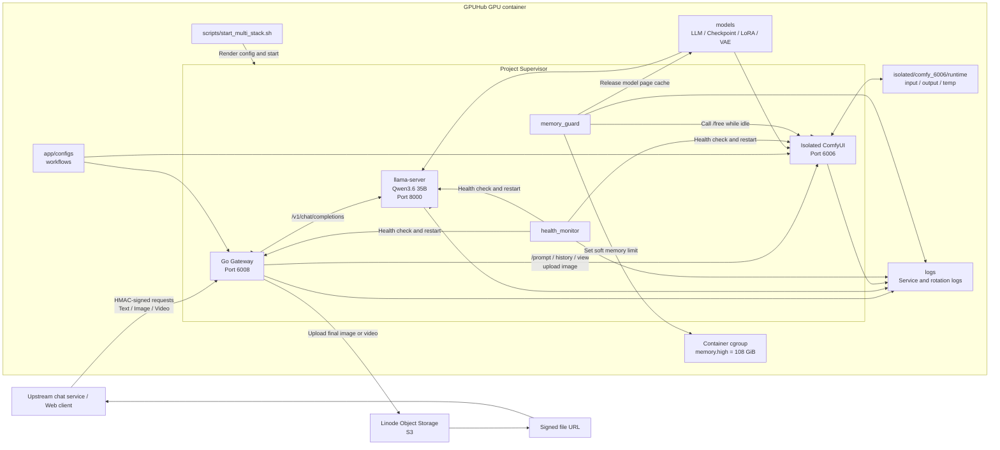

# Deployment Architecture

The current deployment runs one Go Gateway, one local llama server, and one
isolated ComfyUI instance on a single GPUHub GPU container. Supervisor manages
all long-running processes.

The Go Gateway is the single API entry point. Text requests are proxied to the
local llama server, while image and video tasks are submitted to ComfyUI. Final
media must be uploaded to Linode Object Storage, and callers receive signed
URLs. Supervisor restarts exited processes, while `health_monitor` handles
unhealthy processes and `memory_guard` controls idle model memory usage.
