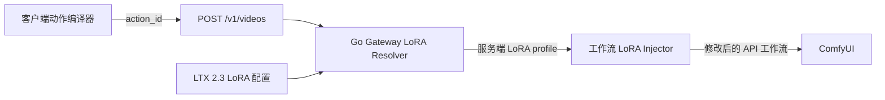

# 视频动态 LoRA 注入方案

状态：已实现，待部署验证
适用范围：LTX 2.3 文生视频、图生视频

## 1. 目标

根据客户端已经确定的动作，为每个视频任务选择对应的 LoRA，
并在提交到 ComfyUI 前动态修改 API 工作流。

核心约束：

- 客户端只传动作语义，不传 LoRA 文件名、权重或 ComfyUI 节点 ID。
- LoRA 文件名、强度和组合顺序全部由 Go Gateway 配置管理。
- 文生视频和图生视频共用同一套动作匹配规则。
- 当前固定 LoRA 保持不变，动态 LoRA 只追加在固定模型链末尾。
- 没有匹配到配置时继续使用原工作流，不应让任务失败。

## 2. 当前实现

当前实现已经完成以下链路：

1. `/v1/videos` 接受可选 `action_id`，空值不会写入任务参数。
2. Gateway 启动时加载并校验 `app/configs/loras/*.yaml`。
3. T2V 和 I2V 在提交 ComfyUI 前统一解析 action profile。
4. 已映射动作在固定模型链末尾动态插入 `LoraLoaderModelOnly`。
5. 未传、空字符串或未映射的 `action_id` 不加载动态 LoRA。
6. 旧的 `params.loras` 只保留给图片生成和图片编辑兼容路径。

当前工作流模型链如下：

```text
文生视频：
281 基础模型
  -> 285 ltx-2.3-22b-distilled-lora-384-1.1.safetensors (0.5)
  -> 282、316 两个 CFGGuider

图生视频：
281 基础模型
  -> 285 ltx-2.3-22b-distilled-lora-384-1.1.safetensors (0.5)
  -> 329 sulphur_ltx23_better_nsfw_motion.safetensors (0.7)
  -> 282、316 两个 CFGGuider
```

两个采样阶段实际消费的是同一条模型链。因此动态 LoRA 只需要插入一次，
然后同时重连节点 `282` 和 `316`，不需要按 stage 分别注入。

## 3. 总体架构



职责边界：

- 客户端负责确定动作 ID。
- Gateway 负责从 ID 解析 LoRA profile。
- 工作流配置负责声明注入锚点。
- Injector 只负责修改工作流图，不处理业务动作含义。

## 4. 请求协议

`POST /v1/videos` 增加一个可选字段：

```json
{
  "motion_prompt": "...",
  "motion_negative_prompt": "...",
  "action_id": "cumshot"
}
```

字段来源：

| Gateway 字段 | 客户端字段 | 说明 |
| --- | --- | --- |
| `action_id` | 动作定义的 canonical ID / 当前 `presetId` | 动作级匹配键 |

协议规则：

- `action_id` 使用稳定的 kebab-case ID。
- 未配置动作的自由提示词可以不传该字段。
- 未映射的合法 ID 正常执行原工作流，只记录未匹配日志。
- 请求不能包含 `loras`、LoRA 文件名、强度或工作流节点 ID。

客户端提示词编译器输出 canonical `actionId`，并沿下面的调用链传递。
Provider 只在值非空时发送 `action_id`：

```text
video-prompt-rewrite-service
  -> VideoModelInput
  -> gateway-video-adapter
  -> gateway-video-provider
  -> POST /v1/videos
```

## 5. LoRA 配置

新增目录：

```text
app/configs/loras/
  ltx_2_3.yaml
```

当前配置格式：

```yaml
id: ltx_2_3
enabled: true

profiles:
  f4c3spl4sh_v1:
    loras:
      - file: "ltx23-f4c3spl4sh-step8500-k3nk.safetensors"
        strength: 1.0
  paizuri_i2v_sulphur_v2:
    loras:
      - file: "ltx23_paizuri_titfuck_i2v_sulphur_v2.safetensors"
        strength: 0.8

actions:
  cumshot: f4c3spl4sh_v1
  missionary-cumshot: f4c3spl4sh_v1
  titjob: paizuri_i2v_sulphur_v2
  titjob-handjob-hybrid: paizuri_i2v_sulphur_v2
```

设计说明：

- `profile` 是有序 LoRA 列表，可以加载一个或多个 LoRA。
- 同一个文件可以在不同 profile 中使用不同强度。
- 动作映射只引用 profile，不重复维护文件和权重。
- 配置中的文件名相对于 ComfyUI 的 `models/loras` 目录。
- Gateway 不添加 LoRA 触发词；客户端必须把所需触发词写入 `motion_prompt`。
- 第一版不做热加载；修改配置后重启 Gateway 生效。

## 6. 匹配规则

Resolver 使用固定规则：

```text
1. action_id 已映射：加载对应 profile
2. action_id 缺失或未映射：不加载动态 LoRA
```

例如：

```text
cumshot              -> f4c3spl4sh_v1
missionary-cumshot   -> f4c3spl4sh_v1
titjob               -> paizuri_i2v_sulphur_v2
titjob-handjob-hybrid -> paizuri_i2v_sulphur_v2
未知或未配置 action_id -> 无动态 LoRA
```

不允许根据提示词关键词选择 LoRA。提示词经过润色后可能出现同义词、遗漏或
额外描述，关键词匹配容易造成错误注入。

具体姿势仍由客户端动作编译器和提示词控制。Gateway 不读取
`poseVariantId`，也不根据同一动作下的姿势切换 LoRA。

## 7. 工作流锚点

在工作流 YAML 中声明动态 LoRA 配置，而不是让客户端传节点号。

文生视频：

```yaml
dynamic_lora:
  catalog: ltx_2_3
  anchor_node: "285"
```

图生视频：

```yaml
dynamic_lora:
  catalog: ltx_2_3
  anchor_node: "285"
```

注入后的模型链：

```text
文生视频：281 -> 285 -> 动态 LoRA 1 -> 动态 LoRA 2 -> 282/316
图生视频：281 -> 285 -> 动态 LoRA 1 -> 动态 LoRA 2 -> 329 -> 282/316
```

`ltx-2.3-22b-distilled-lora-384-1.1.safetensors` 是通用固定 LoRA，
不进入动作配置。图生视频默认保留固定的
`sulphur_ltx23_better_nsfw_motion.safetensors`。

## 8. 注入算法

Injector 按以下顺序修改每个任务的工作流副本：

1. 读取工作流配置中的 `anchor_node`。
2. 保存注入前所有节点 ID，避免后续重连到刚创建的 LoRA 节点。
3. 按 profile 顺序创建 `LoraLoaderModelOnly` 节点。
4. 第一个动态节点连接锚点输出，后续节点连接前一个动态节点。
5. 将所有原来消费锚点 model 输出的节点重连到最后一个动态节点。
6. 原始工作流 JSON 和客户端传入的提示词不做持久化修改。

当前 `relinkNodeInputSourceForNodeIDsExcludingClass` 和最大节点 ID 计算逻辑
可以继续复用。视频路径不再依赖请求中的 `lora_stage_node_ids`、`attach`
或旧的 `params.loras`。

图片生成和图片编辑现有 LoRA 兼容逻辑保持不动，避免扩大修改范围。

## 9. 代码边界

Go Gateway：

| 文件 | 改动 |
| --- | --- |
| `app/model/lora.go` | LoRA catalog、profile、动作映射和工作流锚点结构体 |
| `app/api/v1_types.go` | 增加 `action_id` |
| `app/api/v1_handler.go` | 校验动作字段并写入内部任务参数 |
| `app/service/lora_config.go` | 加载、索引和校验 LoRA 配置 |
| `app/service/lora_video.go` | 动作解析和通用视频 model-only LoRA 注入器 |
| `app/service/lora_multi.go` | 保留图片接口的 `params.loras` 兼容解析 |
| `app/service/task_runner.go` | 文生视频和图生视频统一调用 Resolver 与 Injector |
| `app/configs/workflows/*.yaml` | 配置 catalog 和服务端锚点 |

上游聊天服务：

| 文件 | 改动 |
| --- | --- |
| `video-prompt-rewrite-service.ts` | 输出 canonical `actionId` |
| `model-runtime/types.ts` | `VideoModelInput` 增加动作字段 |
| `generation-orchestrator-service.ts` | 保留并传递动作编译结果 |
| `gateway-video-adapter.ts` | 映射 Gateway 请求字段 |
| `gateway-video-provider.ts` | 发送 `action_id` |

Gateway 的 API、配置和工作流注入测试放在 `test` 目录；上游客户端测试沿用
该项目现有的相邻测试文件，不把业务测试写进入口文件或仓库根目录。

## 10. 启动校验与日志

Gateway 启动时必须校验：

- catalog ID 不重复。
- action ID 格式合法。
- action 引用的 profile 存在。
- profile 至少包含一个 LoRA。
- LoRA 文件名是安全的相对路径，不包含绝对路径或 `..`。
- `strength` 在允许范围内，建议第一版限制为 `0 < strength <= 2`。
- 工作流引用的 catalog 存在。
- 工作流锚点节点存在于对应 API 工作流中。

每次任务选择后记录结构化日志：

```text
[video lora] task=<id> workflow=<id> action=<id>
profile=<id> loras=<file@strength> anchor=<node>
```

没有匹配时记录 `profile=none`。日志不能记录输入图片和完整提示词。

## 11. 测试方案

Gateway 测试：

1. action 映射到正确 profile，且不修改客户端传入的 `motion_prompt`。
2. action 缺失或未映射时不注入 LoRA。
3. 文生视频从节点 `285` 注入并重连 `282`、`316`。
4. 图生视频从节点 `285` 注入，并保留其后的固定节点 `329`。
5. 多 LoRA 按配置顺序串联。
6. 非法配置和不存在的锚点导致启动失败。
7. 公共 API 不接受客户端 LoRA 文件名和节点 ID。

客户端测试：

1. 配置动作的文生视频发送 `action_id`。
2. 配置动作的图生视频发送 `action_id`。
3. 自由提示词不发送动作字段。
4. 请求体不包含 `loras`、文件名或权重。

服务器验收：

1. 无动作字段时生成结果与当前版本一致。
2. 同一请求分别关闭和开启动态 LoRA 做 A/B 对比。
3. 连续执行 `profile A -> profile B -> profile A`，确认显存能够回落或稳定，
   不随 profile 切换持续增长。
4. 分别验证文生视频和图生视频都只插入一个动态模型链。
5. 所有 ComfyUI 实例都能在 `models/loras` 中读取配置文件引用的 LoRA。

## 12. 上线与回滚

推荐上线顺序：

1. 先部署 Gateway 配置、Resolver 和 Injector。旧客户端不传动作字段，行为不变。
2. 将 LoRA 文件部署到所有 ComfyUI 实例共享的模型目录。
3. 只配置一个已经验证的动作，例如 `cumshot`。
4. 更新客户端开始传递动作字段。
5. 完成 T2V、I2V、连续 profile 切换和显存测试后，再逐步添加其他动作。

回滚方式：

```yaml
enabled: false
```

重启 Gateway 后所有任务恢复固定工作流。该回滚不需要修改工作流 JSON，
也不影响现有 distilled LoRA 和图生视频固定 LoRA。

## 13. 表情 LoRA 注意事项

表情类 LoRA 可以使用相同的 profile 机制接入，例如映射到
`ahegao-face`。但候选表情 LoRA 的推荐采样步数通常高于当前 distilled
工作流的低步数配置，不能仅确认节点可加载就直接上线。

表情 LoRA 应先独立验证：

- 低步数下是否生效。
- 是否破坏人物身份和面部结构。
- 与动作 LoRA 串联时的顺序和强度。
- 文生视频和图生视频是否需要不同强度。

第一阶段只上线已经验证的动作 LoRA，表情 LoRA 在测试通过后再加入配置。
